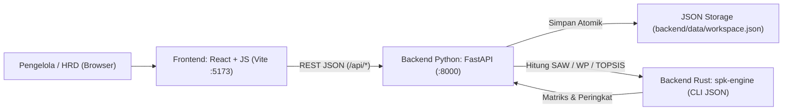
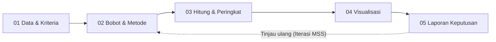

<div align="center">

# SPK Seleksi Calon Karyawan

**Workbench Sistem Pendukung Keputusan (SPK) dalam kerangka Management Support System (MSS)**  
Struktur terpisah penuh antara **Frontend (React + JavaScript)** dan **Backend (Python FastAPI + Rust)**


[Fitur Utama](#fitur-utama-8-ketentuan-proyek) · [Arsitektur](#arsitektur-sistem) · [Metode SPK](#metode-perhitungan-spk) · [Struktur Folder](#struktur-proyek) · [Cara Menjalankan](#cara-menjalankan) · [Pengujian](#pengujian)

</div>

---

## Tentang Proyek

Proyek ini merupakan implementasi aplikasi web **Sistem Pendukung Keputusan (SPK)** untuk kasus **Seleksi Calon Karyawan** pada mata kuliah Sistem Pendukung Keputusan (S1 Informatika).

Berangkat dari konsep **Management Support System (MSS)** (*Sharda, Delen, & Turban, 2021*), seleksi karyawan diperlakukan sebagai **keputusan semi-terstruktur**:

- **Peran Sistem:** mengelola data alternatif dan kriteria, menormalisasi bobot, menjalankan perhitungan otomatis metode **SAW**, **WP**, dan **TOPSIS**, menyajikan transparansi matriks langkah demi langkah, serta memvisualisasikan perbandingan skor.
- **Peran Manusia (Pengelola / HRD):** memeriksa kualitas data dan asumsi, membandingkan sensitivitas peringkat lintas metode, menambahkan catatan pertimbangan lapangan, lalu menetapkan keputusan akhir (`Lanjut wawancara akhir`, `Cadangan`, atau `Tidak lolos`).

> **Catatan Data:** Seluruh data calon karyawan bawaan (`A1`–`A6`) bersifat **ilustrasi pembelajaran**, bukan data pelamar nyata.

---

## Fitur Utama (8 Ketentuan Proyek)

| No | Ketentuan Minimum Proyek | Implementasi di Aplikasi | Lokasi Tab |
| :-: | --- | --- | --- |
| 1 | **Manajemen data alternatif (min. 4)** | CRUD calon karyawan lengkap, form nilai dinamis mengikuti kriteria aktif, pencarian, filter posisi, konfirmasi hapus, indikator batas `6/4`. | `01 Data dan kriteria` |
| 2 | **Manajemen kriteria (min. 5)** | CRUD kriteria dengan atribut `benefit` / `cost`, satuan, bobot, sinkronisasi otomatis ke seluruh alternatif, indikator batas `5/5`. | `01 Data dan kriteria` |
| 3 | **Pengaturan bobot kriteria** | Pengaturan langsung via slider & angka, distribusi proporsi bobot visual, indikator total `100%`, dan tombol **Normalisasi ke 100%**. | `02 Bobot dan metode` |
| 4 | **Pemilihan metode SPK** | Pemilih metode aktif **SAW**, **WP**, dan **TOPSIS** lengkap dengan ringkasan cara kerja dan pratinjau rumus aktif. | `02 Bobot dan metode` |
| 5 | **Proses perhitungan otomatis** | Recalculate otomatis saat data/bobot berubah + panel **Audit Perhitungan** (Matriks `X`, Normalisasi `R`, Terbobot / Vektor `S` / Solusi Ideal `A+` & `A-` serta Jarak `D+` & `D-`). | `03 Hitung dan peringkat` |
| 6 | **Hasil perankingan** | Tabel peringkat terurut (`#1..#N`), skor 4 desimal, komparasi peringkat lintas 3 metode, serta kolom **Keputusan Pengelola & Catatan Manusia**. | `03 Hitung dan peringkat` |
| 7 | **Grafik visualisasi** | 3 grafik SVG murni responsif bersumbu nol: peringkat skor metode aktif, komparasi 3 metode, dan profil keunggulan per kriteria antar 2 kandidat. | `04 Visualisasi` |
| 8 | **Laporan hasil keputusan** | Lembar keputusan resmi siap **Cetak / Simpan PDF** (`@media print`), ekspor **CSV** (UTF-8 BOM untuk Excel) & **JSON**, plus checklist kualitas data & privasi MSS. | `05 Laporan keputusan` |

---

## Arsitektur Sistem

Frontend dan backend dipisahkan secara tegas sehingga masing-masing dapat dikembangkan, diuji, dan dijalankan secara independen.



### Alur Kerja Aplikasi (Siklus Pengambilan Keputusan)



> **Jembatan Python ↔ Rust:** FastAPI memanggil binary Rust `backend/rust/target/release/spk-engine` melalui JSON `stdin`/`stdout`. Jika toolchain Rust belum terpasang di komputer lokal, `engine_bridge.py` otomatis memakai `spk_fallback.py` dengan rumus yang 100% identik dan melaporkan sumber mesin secara transparan (`"engine": "rust"` atau `"python-fallback"`).

---

## Metode Perhitungan SPK

Seluruh bobot input $b_j > 0$ dinormalisasi terlebih dahulu menjadi $w_j = \dfrac{b_j}{\sum_{k=1}^{n} b_k}$ sehingga $\sum w_j = 1$.

<details>
<summary><strong>1. SAW (Simple Additive Weighting)</strong></summary>

Normalisasi matriks keputusan $X = [x_{ij}]$:

$$r_{ij} = \begin{cases} \dfrac{x_{ij}}{\max_i(x_{ij})} & \text{jika } C_j \text{ bertipe benefit} \\ \dfrac{\min_i(x_{ij})}{x_{ij}} & \text{jika } C_j \text{ bertipe cost} \end{cases}$$

Skor preferensi akhir:

$$V_i = \sum_{j=1}^{n} w_j \cdot r_{ij}$$

</details>

<details>
<summary><strong>2. WP (Weighted Product)</strong></summary>

Bobot bertanda $w'_j = +w_j$ untuk `benefit` dan $w'_j = -w_j$ untuk `cost`. Vektor $S$ dihitung menggunakan log-eksponensial demi stabilitas numerik:

$$S_i = \prod_{j=1}^{n} x_{ij}^{w'_j} = \exp\left(\sum_{j=1}^{n} w'_j \ln(x_{ij})\right), \qquad V_i = \frac{S_i}{\sum_{k=1}^{m} S_k}$$

</details>

<details>
<summary><strong>3. TOPSIS (Technique for Order Preference by Similarity to Ideal Solution)</strong></summary>

Normalisasi Euclidean dan matriks terbobot $Y$:

$$r_{ij} = \frac{x_{ij}}{\sqrt{\sum_{k=1}^{m} x_{kj}^2}}, \qquad y_{ij} = w_j \cdot r_{ij}$$

Solusi ideal positif $A^+$ dan negatif $A^-$, jarak Euclidean $D^+_i, D^-_i$, dan skor kedekatan relatif:

$$D^+_i = \sqrt{\sum_{j=1}^{n} (y_{ij} - A^+_j)^2}, \qquad D^-_i = \sqrt{\sum_{j=1}^{n} (y_{ij} - A^-_j)^2}, \qquad C_i = \frac{D^-_i}{D^+_i + D^-_i}$$

</details>

### Hasil Perankingan Dataset Ilustrasi Bawaan

Kriteria bawaan: `C1` Skor Tes Teknis (`benefit`, 30%), `C2` Skor Wawancara (`benefit`, 20%), `C3` Pengalaman Kerja (`benefit`, 20%), `C4` Portofolio & Kompetensi (`benefit`, 15%), `C5` Ekspektasi Gaji (`cost`, 15%).

| Peringkat | Kode | Calon Karyawan | Posisi | Skor SAW | Skor WP | Skor TOPSIS |
| :-: | :-: | --- | --- | --: | --: | --: |
| **#1** | `A6` | Farhan Hakim | Fullstack Developer | `0.9281` | `0.1957` | `0.8265` |
| #2 | `A2` | Bagas Nugroho | Backend Developer | `0.8644` | `0.1813` | `0.6363` |
| #3 | `A1` | Alya Pratama | Frontend Developer | `0.8366` | `0.1726` | `0.4134` |
| #4 | `A4` | Dimas Saputra | QA Engineer | `0.8013` | `0.1661` | `0.3811` |
| #5 | `A3` | Citra Lestari | Frontend Developer | `0.7727` | `0.1478` | `0.2303` |
| #6 | `A5` | Eka Putri | Backend Developer | `0.7068` | `0.1365` | `0.1945` |

---

## Struktur Proyek

```text
Seleksi Calon Karyawan-SPK/
├── frontend/                           # Aplikasi Frontend React + JavaScript (Vite)
│   ├── index.html                      # Entry HTML + font Familjen Grotesk, IBM Plex Sans, JetBrains Mono
│   ├── package.json                    # Dependensi minimal (react, react-dom, vite)
│   ├── vite.config.js                  # Dev server :5173 + proxy /api -> :8000
│   ├── src/
│   │   ├── main.jsx & App.jsx          # Bootstrap aplikasi, routing hash (#data..#laporan), state utama
│   │   ├── styles/                     # tokens.css (OKLCH Cobalt) & app.css (termasuk @media print)
│   │   ├── data/sampleWorkspace.js     # Dataset ilustrasi 5 kriteria & 6 alternatif
│   │   ├── models/spkEngine.js         # Logika murni SAW, WP, TOPSIS, validasi & ekspor CSV
│   │   ├── services/spkApi.js          # Adapter mode lokal browser & REST API backend
│   │   └── components/                 # HeaderTray, DataManagementTab, WeightsMethodTab,
│   │                                   # CalculationRankingTab, VisualizationTab, ReportTab, StateViews
│   └── tests/spkEngine.test.mjs        # Unit test Node built-in untuk seluruh rumus & edge cases
│
└── backend/                            # Backend terpisah Python + Rust
    ├── README.md                       # Dokumentasi kontrak endpoint REST API & panduan Rust
    ├── data/workspace.sample.json      # Seed JSON bersama
    ├── python/                         # FastAPI REST API + Pydantic + penyimpanan atomik JSON
    │   ├── pyproject.toml
    │   ├── app/
    │   │   ├── main.py                 # Konfigurasi FastAPI & CORS
    │   │   ├── schemas.py              # Validasi skema Pydantic
    │   │   ├── storage.py              # Baca/tulis file JSON atomik
    │   │   ├── engine_bridge.py        # Jembatan subprocess ke binary Rust (+ fallback otomatis)
    │   │   ├── spk_fallback.py         # Engine SAW/WP/TOPSIS Python identik dengan Rust & JS
    │   │   └── routes/spk.py           # Endpoint /api/*
    │   └── tests/test_api.py           # Pengujian API & paritas rumus (pytest)
    └── rust/                           # Crate komputasi inti spk-engine
        ├── Cargo.toml
        └── src/
            ├── lib.rs                  # Implementasi type-safe SAW, WP, TOPSIS + unit tests
            └── main.rs                 # Entry CLI JSON stdin -> stdout
```

---

## Cara Menjalankan

### Prasyarat
- **Node.js** 20+ (di PowerShell Windows, gunakan `npm.cmd` bila ExecutionPolicy memblokir `npm.ps1`)
- **Python** 3.11+ & **[uv](https://docs.astral.sh/uv/)** (atau `pip`)
- **Rust (`rustup` / `cargo`)** — opsional untuk mengompilasi binary native `spk-engine`

### 1. Jalankan Frontend Saja (Mode Lokal Browser)
Frontend langsung berjalan penuh dengan penyimpanan `localStorage` tanpa perlu menyalakan backend:

```powershell
cd frontend
npm.cmd install
npm.cmd run dev
```

Buka **`http://localhost:5173`** di browser.

### 2. Jalankan Fullstack (Frontend React + Backend FastAPI)

**Terminal 1 — Backend Python (`:8000`):**
```powershell
cd backend\python
uv sync
uv run uvicorn app.main:app --reload --port 8000
```

**Terminal 2 — Frontend React (`:5173`):**
```powershell
cd frontend
npm.cmd run dev
```

Buka **`http://localhost:5173/?api=/api`** (Vite otomatis meneruskan `/api` ke FastAPI di port `8000`).  
Dokumentasi interaktif Swagger API tersedia di **`http://localhost:8000/docs`**.

### 3. Aktifkan Engine Rust (Opsional)
Setelah `rustup` terpasang, kompilasi binary release sekali saja:

```powershell
cd backend\rust
cargo test
cargo build --release
```

FastAPI otomatis mendeteksi `backend/rust/target/release/spk-engine(.exe)` dan beralih dari `"python-fallback"` ke `"rust"`.

<details>
<summary><strong>Daftar Endpoint REST API Backend</strong></summary>

| Method | Endpoint | Deskripsi |
| --- | --- | --- |
| `GET` | `/api/health` | Status server & engine aktif (`rust` / `python-fallback`) |
| `GET` | `/api/workspace` | Ambil metadata seleksi, kriteria, dan alternatif |
| `PUT` | `/api/workspace` | Simpan perubahan penuh workspace secara atomik |
| `POST` | `/api/workspace/reset` | Kembalikan data ke seed ilustrasi awal |
| `POST / PUT / DELETE` | `/api/criteria` | Kelola kriteria (sinkron otomatis ke seluruh alternatif) |
| `POST / PUT / DELETE` | `/api/alternatives` | Kelola alternatif (validasi nilai `> 0`) |
| `PUT` | `/api/weights` | Perbarui bobot kriteria massal |
| `POST` | `/api/calculate` | Hitung SAW, WP, TOPSIS lengkap dengan matriks langkah & ranking |

Detail skema payload dapat dilihat di [backend/README.md](backend/README.md).

</details>

---

## Pengujian

```powershell
# 1. Unit test model SPK Frontend (8 test) & production build
cd frontend
npm.cmd test
npm.cmd run build

# 2. Unit test REST API & validasi Backend Python (3 test)
cd ..\backend\python
uv run pytest -v

# 3. Unit test Engine Rust (setelah cargo terpasang)
cd ..\rust
cargo test
```

Verifikasi yang telah lulus:
- `frontend`: **8/8 unit test lulus** (SAW, WP, TOPSIS, *edge case* kandidat identik tanpa `NaN`, validasi duplikat & nilai `<= 0`, normalisasi bobot 100%, sinkronisasi kriteria, ekspor CSV BOM) dan `vite build` sukses.
- `backend/python`: **3/3 `pytest` lulus** dan hasil numerik SAW, WP, TOPSIS cocok **persis hingga 6 angka desimal** dengan engine JavaScript.

---

## Referensi

- Sharda, R., Delen, D., & Turban, E. (2021). *Analytics, Data Science, & Artificial Intelligence: Systems for Decision Support*. Pearson.
